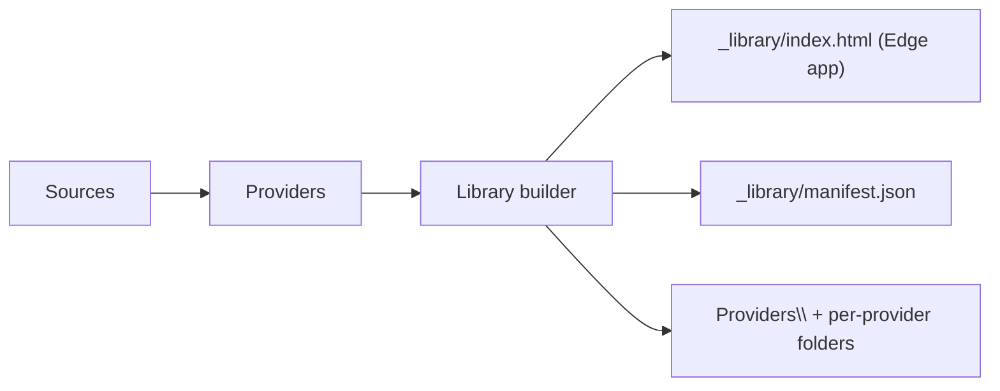

# Games Library Manager

PowerShell 5.1 tool that scans installed games and rebuilds an organized shortcut
library. It covers storefronts, standalone games with official launchers,
community launchers, and emulator ROMs, then produces a clean folder tree plus an
HTML index.

Nothing is installed on `C:`. The script only reads registry keys, storefront
manifests, and game folders, and writes shortcuts to the library folder you choose.



## Quick start

From this folder:

```bat
games-library.cmd -DryRun
games-library.cmd -Force
```

- `-DryRun` scans and reports what would be created without writing anything.
- `-Force` is required the first time, because `D:\Games` already exists and was
  not created by this tool. The old folder is moved to a sibling backup such as
  `D:\Games_backup_20261113_143000` before the new library is built.

After the first run:

```bat
games-library.cmd
games-library.cmd -Open
```

`-Open` opens `_library\index.html` when it exists, otherwise the library folder.

## Requirements

- Windows with Windows PowerShell 5.1 (built in; no PowerShell 7 needed).
- No Node, Python, Git, or npm required.

## Options

```text
-LibraryRoot <path>   Library folder. Defaults to config libraryRoot (D:\Games).
-Config <path>        Settings file. Defaults to config\settings.json.
-DryRun               Scan and report without writing files.
-Open                 Open the HTML index or library folder when done.
-Force                Back up and replace an unmanaged non-empty library root.
-NoIndex              Skip _library\index.html.
-NoClean              Keep shortcuts from the previous run instead of removing stale ones.
-NoFolderIcons        Skip desktop.ini folder icons.
-Only <providers>     Run only selected providers, e.g. steam,itch,standalone.
-InitRoms             Create a per-console ROM folder structure and exit.
-RomRoot <path>       Target for -InitRoms. Defaults to the first scan.romRoots
                      entry, or D:\ROMs when none is configured.
-Help                 Show built-in help.
```

## Library layout

```text
D:\Games\
  Providers\
    Steam.lnk
    itch.io.lnk
    ...
  Steam\
    Game Name.url
    Another Game.url
  itch.io\
    Game Name.lnk
  Standalone\
    FINAL FANTASY XIV.lnk
    Guild Wars 2.lnk
    Elite Dangerous.lnk
  Custom Launchers\
    XIVLauncher.lnk
    RuneLite.lnk
  Dolphin\
    Zelda Wind Waker.lnk
  RetroArch\
    Crash Bandicoot.lnk
  _library\
    manifest.json
    index.html
    last-run.log
```

- `Providers\` contains storefront and emulator launcher shortcuts only.
- Each storefront gets a folder containing that storefront's game shortcuts.
- Each installed emulator gets its own folder containing that emulator's ROM
  shortcuts.
- Protocol launches use `.url` files (`steam://`, `com.epicgames.launcher://`, etc.).
- Executable launches use `.lnk` files with the correct working directory and icon.
- ROM shortcuts launch the emulator with the ROM path (or ROM name for MAME).
- `Standalone\` holds games installed outside a storefront, including games that
  ship their own official launcher.
- `Custom Launchers\` holds community tools and launchers such as XIVLauncher,
  RuneLite, WoWUp, CurseForge, Prism Launcher, Heroic, Playnite, and Vortex.

## Library view

The generated `_library\index.html` is a cover-art grid with search and
provider filters. Open it in a desktop window with:

```bat
games-library.cmd -Open
```

This launches Microsoft Edge in application mode, using the engine already
installed on Windows 11. No browser or runtime is installed by the tool. Covers
come from store-provided art (Steam headers, itch covers) cached under
`_library\artwork\`. Games without art show a generated placeholder.

Storefronts:

- Steam
- Epic Games
- GOG
- itch.io
- Amazon Games
- Legacy Games
- EA app / Origin
- Ubisoft Connect
- Battle.net
- Rockstar Games
- Riot Games
- Wargaming
- Hi-Rez Studios
- Xbox / Microsoft Store

Standalone games with official launchers are curated in
`src\Providers\Standalone.ps1`. The current list includes:

- Final Fantasy XIV
- Guild Wars 2
- Path of Exile and Path of Exile 2
- Star Citizen
- Escape from Tarkov
- Black Desert Online
- Genshin Impact
- Honkai: Star Rail
- Zenless Zone Zero
- Wuthering Waves
- Honkai Impact 3rd
- Tower of Fantasy
- Minecraft
- Roblox
- The Elder Scrolls Online
- Star Wars: The Old Republic
- Warframe
- Elite Dangerous
- EVE Online
- Albion Online
- RuneScape / Jagex Launcher
- Star Trek Online
- Neverwinter
- The Lord of the Rings Online
- Dungeons & Dragons Online

Standalone detection checks registry install keys, uninstall records, known
official-launcher paths, and the configured search roots. Any game that is also
found by a storefront provider is skipped in `Standalone\` to avoid duplicates.

### itch.io build formats

itch.io games are not limited to `.exe`. A build is resolved in this order:

1. Native executable, preferring the real 64-bit game binary over alternate
   32-bit or engine/runtime helpers.
2. Java `.jar` with a bundled or system Java runtime.
3. A `.bat`/`.cmd` launcher that runs Java.
4. A Flash `.swf` with a bundled or system Flash/Ruffle player.
5. An HTML entry point, opened as a file URL.
6. A raw `.swf` using the system file association.

Runtime and helper binaries such as `python.exe`, `nwjc.exe`, `steamcmd.exe`,
`zsync*.exe`, `chardetect.exe`, crash handlers, and prerequisite installers are
never treated as the game.

## Emulators

Installed emulators are detected from their executables, install records, and the
configured emulator roots. Each emulator that has recognizable ROMs gets its own
folder and a launcher shortcut in `Providers\`.

Supported emulators include Dolphin, Cemu, PCSX2, RPCS3, DuckStation, PPSSPP,
melonDS, DeSmuME, Citra, yuzu, Ryujinx, mGBA, Snes9x, Project64, Mupen64Plus,
Flycast, redream, xemu, Xenia, Vita3K, Cxbx-Reloaded, FCEUX, Mesen, Nestopia,
Kega Fusion, Mednafen, BizHawk, ScummVM, MAME, and RetroArch.

ROM roots are configured with `scan.romRoots`. When it is empty, the tool probes
common locations such as `D:\ROMs`, `D:\Emulation\roms`, and `%USERPROFILE%\ROMs`.

Ambiguous extensions such as `.iso`, `.cue`, `.chd`, `.bin`, and `.zip` are only
assigned when a system folder name matches an emulator, or when only one emulator
can run that format. RetroArch is used as the fallback for otherwise ambiguous
files. MAME `.zip` sets require an `arcade` or `mame` folder hint.

Multi-file disc images are treated as one game: a `.bin` with a sibling `.cue`,
or a `.mdf` with a `.mds`, does not become a second shortcut. If a title exists in
several formats, the best dump is kept. PS3 folders containing `PS3_GAME` and
Xbox 360 folders containing `default.xex` are also detected.

## Configuration

`config\settings.json` controls the library root, provider toggles, standalone
search roots, and custom entries.

```json
{
  "libraryRoot": "D:\\Games",
  "createHtmlIndex": true,
  "createFolderIcons": true,
  "removeStaleShortcuts": true,
  "providers": {
    "steam": true,
    "epic": true,
    "emulators": true
  },
  "scan": {
    "extraGameRoots": [],
    "standaloneSearchRoots": [
      "%ProgramFiles%",
      "%ProgramFiles(x86)%",
      "%LOCALAPPDATA%\\Programs"
    ],
    "standaloneDepth": 4,
    "romRoots": [
      "D:\\ROMs"
    ],
    "romDepth": 5,
    "emulatorRoots": [
      "D:\\Emulators"
    ]
  },
  "customEntries": [],
  "customLaunchers": []
}
```

`providers` is merged with the defaults, so you only need to list entries you want
to change. Set a provider to `false` to skip it.

## Secrets and API keys

Metadata providers such as SteamGridDB, Steam Web API, and IGDB need credentials.
They are never stored in `config/settings.json`, the manifest, logs, or HTML.

Store a secret securely with the Windows Data Protection API (DPAPI), which ties
it to the current Windows user:

```bat
games-library.cmd -SetSecret steamgriddb
games-library.cmd -SetSecret steamWebApi
games-library.cmd -SetSecret igdbClientId
```

You will be prompted for the value (input is not echoed). Then reference it in
config:

```json
"artwork": {
  "providers": {
    "steamGridDb": { "enabled": true, "apiKey": "{secret:steamgriddb}" }
  }
}
```

Other supported forms:

- `{env:STEAMGRIDDB_API_KEY}` reads an environment variable. A local `.env`
  file in the repository root is loaded automatically at startup (gitignored),
  so you can keep dev keys there. See `.env.example`.
- A plain value works but is not recommended.

Manage stored secrets:

```bat
games-library.cmd -ListSecrets
games-library.cmd -RemoveSecret steamgriddb
```

Notes:

- Secrets are encrypted for the current Windows user and stored in
  `%LOCALAPPDATA%\GamesLibraryManager\secrets.dat`, outside the repository and
  the library root.
- They do not roam with the user profile and must be re-entered after a profile
  change or on another machine.
- The build still succeeds when a secret is missing; that provider is simply
  skipped.

### Extra game roots

Use `scan.extraGameRoots` for standalone games installed in non-standard folders:

```json
"extraGameRoots": [
  "D:\\Standalone Games",
  "E:\\Games"
]
```

Each root is checked both as a game folder and as a parent folder containing games.
Folders named `bin`, `data`, `cache`, `redist`, `support`, and similar are ignored.

### ROM and emulator roots

Point `scan.romRoots` at your ROM folders and `scan.emulatorRoots` at portable
emulator installs:

```json
"romRoots": [
  "D:\\ROMs",
  "E:\\Emulation\\roms"
],
"romDepth": 5,
"emulatorRoots": [
  "D:\\Emulators",
  "%LOCALAPPDATA%\\Programs"
]
```

- `romRoots` is scanned recursively to `romDepth`.
- `emulatorRoots` is used to find portable emulator executables by name.
- Standard installs are still detected through program files and uninstall
  records, so these roots are only needed for portable setups.
- Use system-named subfolders (`PS2`, `GameCube`, `Wii`, `Switch`, `MAME`) to
  disambiguate formats shared by several emulators.

### Scaffolding ROM folders

Create a ready-to-fill ROM root with one folder per console:

```bat
games-library.cmd -InitRoms -RomRoot D:\ROMs
```

Preview without writing:

```bat
games-library.cmd -InitRoms -RomRoot D:\ROMs -DryRun
```

When `-RomRoot` is omitted, the first `scan.romRoots` entry is used, falling back
to `D:\ROMs`. Existing folders are left alone, so the command is safe to rerun.
The scaffold creates these folders: NES, SNES, N64, GameCube, Wii, Wii U, Switch,
Game Boy, Game Boy Color, GBA, NDS, 3DS, PS1, PS2, PS3, PSP, PS Vita, Dreamcast,
Saturn, Genesis, Master System, Game Gear, 32X, Xbox, Xbox 360, Arcade, and
ScummVM.

`-InitRoms` only scaffolds folders. It does not scan or build the library.

### Custom entries

Add a shortcut to an existing provider folder, or create a new section:

```json
"customEntries": [
  {
    "name": "My Modded Game",
    "provider": "Standalone",
    "target": "D:\\Modded Games\\MyGame\\Game.exe",
    "arguments": "-windowed",
    "icon": "D:\\Modded Games\\MyGame\\icon.ico"
  },
  {
    "name": "Private Server Client",
    "provider": "Custom",
    "target": "D:\\Servers\\Client.lnk"
  }
]
```

`provider` can be a provider key such as `steam`, `itch`, or `standalone`, or a
display name. Unknown names create a new section using that name.

### Custom launchers

Add a community launcher or tool to `Custom Launchers\`:

```json
"customLaunchers": [
  {
    "name": "Mod Organizer 2",
    "path": "D:\\MO2\\ModOrganizer.exe",
    "arguments": "",
    "workingDirectory": "D:\\MO2",
    "icon": "D:\\MO2\\ModOrganizer.exe"
  },
  {
    "name": "My Launcher",
    "path": "D:\\Launchers\\MyLauncher.exe"
  }
]
```

A string path is also accepted:

```json
"customLaunchers": [
  "D:\\MO2\\ModOrganizer.exe"
]
```

## Metadata and artwork

The viewer's cover art comes from store-provided images first (Steam headers,
itch covers). Missing art is fetched from metadata providers, in this order:

1. Steam store (keyless, for Steam games without a local header).
2. SteamGridDB (requires API key).
3. IGDB (requires client id + secret).
4. VNDB (keyless, for visual novels).

Enable and configure them in `config/settings.json` (or via the settings page in
the GUI):

```json
"metadata": {
  "enabled": true,
  "providers": {
    "steamStore": { "enabled": true },
    "steamGridDb": { "enabled": false, "apiKey": "{secret:steamgriddb}" },
    "igdb": { "enabled": false, "clientId": "{secret:igdbClientId}", "clientSecret": "{secret:igdbClientSecret}" },
    "vndb": { "enabled": false }
  }
}
```

Store credentials securely:

```bat
games-library.cmd -SetSecret steamgriddb
games-library.cmd -SetSecret igdbClientId
games-library.cmd -SetSecret igdbClientSecret
```

Artwork is cached under `_library\artwork\` with an `index.json`. Repeated runs
reuse the cache; missing art is recorded as a miss so it is not retried every
run. All requests are rate-limited and throttled to avoid CDN blocks.

## Safety and cleanup

- The tool refuses to replace an unmanaged non-empty library without `-Force`.
- With `-Force`, the old folder is moved to a timestamped sibling backup first.
- Drive roots, the Windows directory, and empty roots are rejected.
- `_library\manifest.json` records only files and folders created by this tool.
- On rebuild, only previously generated shortcuts are removed. User files are left
  alone unless the whole library root is replaced with `-Force`.
- Use `-NoClean` to keep old shortcuts, or `-NoFolderIcons` to skip `desktop.ini`.
- The run log is written to `_library\last-run.log`.

## Notes

- Epic Games is only treated as installed when an uninstall record exists. Leftover
  launcher files or manifests from an incomplete uninstall are ignored; game
  manifests pointing to missing install folders are skipped as well.
- Xbox games are detected through AppX package manifests and launched through
  `explorer.exe shell:AppsFolder\<AUMID>`.
- itch.io titles come from `.itch\receipt.json.gz`, and game executables are
  selected by name and size scoring.
- Emoji are stripped from game titles and shortcut names because the Windows
  shortcut API cannot save names containing non-BMP characters.
- Titles are normalized to remove common developer metadata such as version
  numbers, release dates, platform/free-version tags, marketing counts, and
  `(NSFW 18+)`-style labels.
- Unusual titles are handled by curated overrides in `src\Core\Titles.ps1`,
  which run before the general regex. Overrides can clean marketing-heavy titles
  (itch.io's `Relicts of Aeson`) or protect published titles that the regex
  would otherwise trim too aggressively (`CUPID - A free to play Visual Novel`,
  `Love Sucks: Night One`, `Love Sucks: Night Two`).
- Locale-specific quote characters that stand in for an apostrophe are normalized
  to a plain `'` (for example itch.io's `Sarada´s Rise`), which keeps shortcut
  names conventional without removing valid punctuation.
- Steam skips redistributables, Proton/runtime packages, soundtracks, and
  dedicated servers.

## Adding a supported game

For a new standalone game, add a definition in `src\Providers\Standalone.ps1`
with install paths, folder names, executable candidates, and an optional uninstall
name pattern. For one-off additions, use `customEntries` or `customLaunchers` in
`config\settings.json` instead.

If a game's official title contains unusual metadata that the general regex
filter cannot safely remove, or the regex is too aggressive for a real title,
add a hand-rolled entry to `Get-CuratedTitleOverride` in `src\Core\Titles.ps1`.
Match on the provider source and id, the install folder name, or a tight title
pattern, and return the exact title to use.
