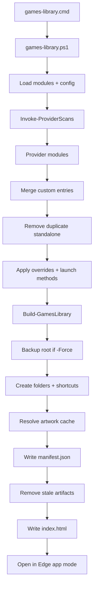

# Architecture

See `agents/context/architecture.md` for the full architecture. Summary:

- Entrypoint `games-library.ps1` loads core modules from `src/Core/` and providers
  from `src/Providers/`.
- `Invoke-ProviderScans` runs selected providers, merges custom entries, removes
  duplicate standalone games, applies custom launch methods and game overrides.
- `Build-GamesLibrary` creates folders and shortcuts, resolves artwork, writes
  the manifest and HTML index, and removes stale artifacts.
- The viewer is a single HTML page launched via Edge app mode.

## Modules

| Module | Responsibility |
| --- | --- |
| `Common.ps1` | Config, logging, names, entries, provider results, secrets loader |
| `Discovery.ps1` | Registry, drives, executables, bitness, JSON, Edge path |
| `Titles.ps1` | Title normalization and curated overrides |
| `Shortcuts.ps1` | `.lnk` and `.url` creation, icons |
| `Index.ps1` | HTML index (cover grid viewer) |
| `Library.ps1` | Root backup, folder build, manifest, stale cleanup |
| `Secrets.ps1` | DPAPI secret storage |
| `Artwork.ps1` | Artwork cache and store-first resolution |
| `Metadata.ps1` | Remote metadata providers |