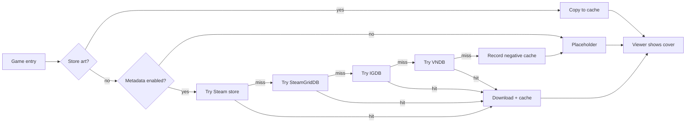

# Artwork and metadata

The viewer's cover art comes from store-provided images first (Steam headers,
itch covers). Missing art is fetched from metadata providers:

1. Steam store (keyless).
2. SteamGridDB (requires API key).
3. IGDB (requires client id + secret).
4. VNDB (keyless, for visual novels).

Artwork is cached under `_library\artwork\` with an `index.json`. Repeated runs
reuse the cache. Missing art is recorded as a miss. All requests are
rate-limited.

The viewer also supports a per-game settings cog that generates a patch file
applied with `-ApplyGameSettings`. See `docs/developer/providers.md`.